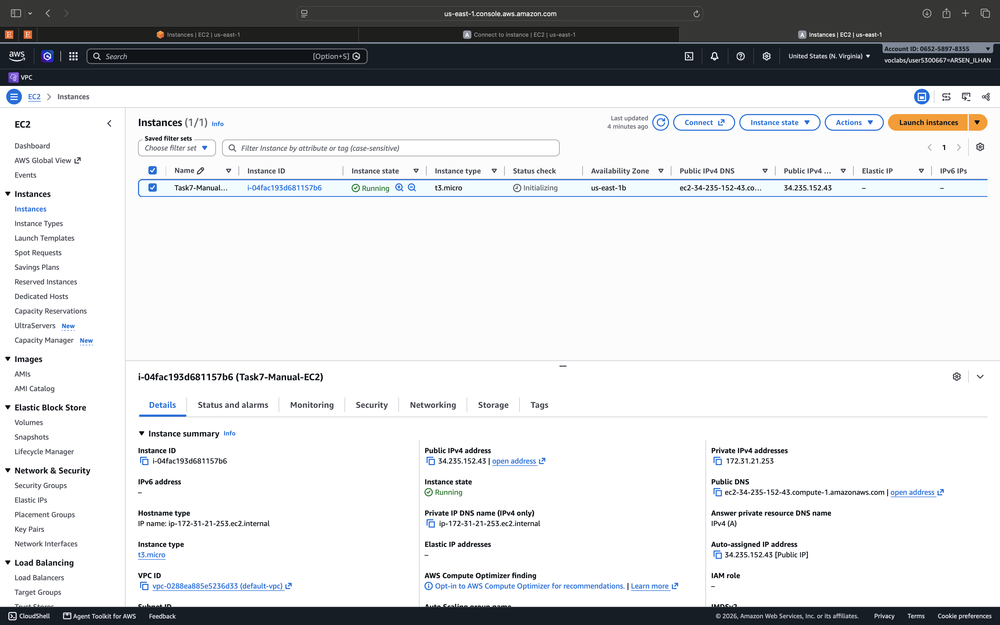
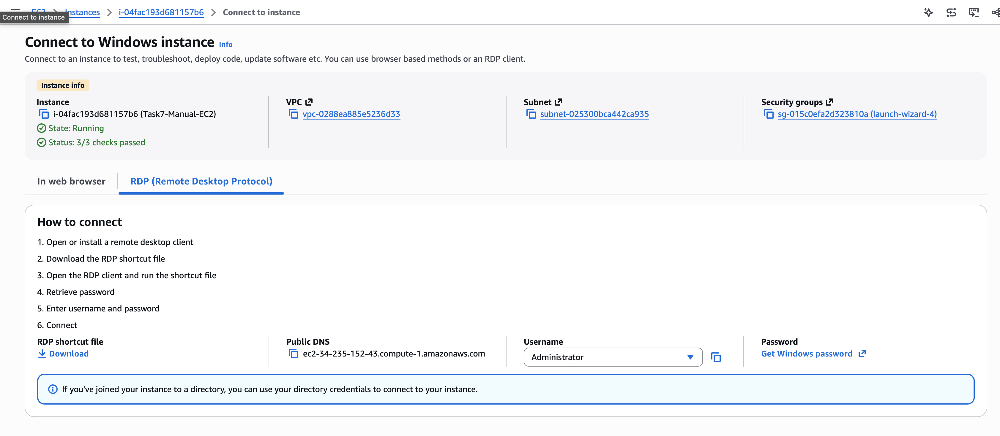
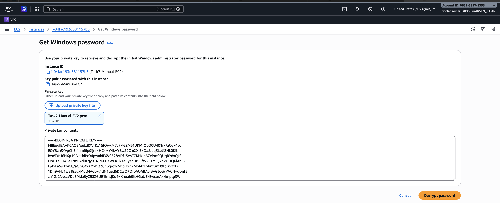

# Virtual Assessment 3 – AWS Infrastructure as Code

## Overview

This repository contains the files and documentation for Virtual Assessment 3. The project demonstrates manual deployment of an Amazon EC2 instance, remote desktop connectivity, and Infrastructure as Code (IaC) using AWS CloudFormation.

## Assessment Tasks

### Task 7.1 – Manually Deploy a VM in AWS

- Created a Windows Server 2025 EC2 instance using the AWS Management Console.
- Configured the instance and its access settings.
- Retrieved the Windows Administrator password.
- Established a Remote Desktop Protocol (RDP) connection from Windows App on macOS.
- Verified that the remote Windows Server desktop was accessible.
- 
**1. EC2 instance created**


**2. RDP password retrieval**


**3. Successful RDP connection**


**4.  RDP connection**


### Task 7.2 – Create a Git Repository

- Created this GitHub repository to store the Infrastructure as Code template.
- Used GitHub for version control and tracking template changes.

**Evidence:** Repository screenshots will be added here.

### Task 7.3 – Create an IaC Template

- Created an AWS CloudFormation template using YAML.
- Defined the AWS resources and configuration required for deployment.

**Evidence:** CloudFormation template screenshots will be added here.

### Task 7.4 – Deploy Infrastructure Using IaC

- Used AWS CloudFormation to deploy infrastructure from the YAML template.
- Verified the deployment status and the availability of the deployed resources.

**Evidence:** CloudFormation stack and deployed EC2 instance screenshots will be added here.

### Task 7.5 – Change the IaC Template

- Modified the original CloudFormation template.
- Committed the updated version to the GitHub repository.
- Used Git version history to demonstrate the changes between template versions.

**Evidence:** Screenshots showing the original template, updated template and Git commit history will be added here.

## Repository Structure

```text
Virtual-Assesment3/
│
├── README.md
│
└── cloudformation/
    └── ec2-template.yaml
```

*Additional files may be added as the assessment progresses.*

## Technologies and Tools

- Amazon Web Services (AWS)
- Amazon EC2
- AWS CloudFormation
- Windows Server 2025
- Remote Desktop Protocol (RDP)
- Git and GitHub
- YAML

## Notes

This repository is maintained as part of Virtual Assessment 3. Screenshots and supporting evidence will be added as each assessment task is completed
